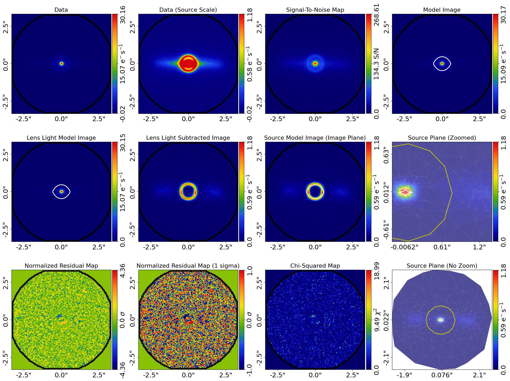

# System 471967

Adopted final-stage result for TNG50 subhalo 471967.

- [Weighted parameter summaries](parameters.json)
- [Original model report](model.results) · [Model definition](model.json)
- [Run settings and checksums](metadata.json)
- [Logarithmic diagnostic](fit_log10.png) · [Tracer](tracer.png)

